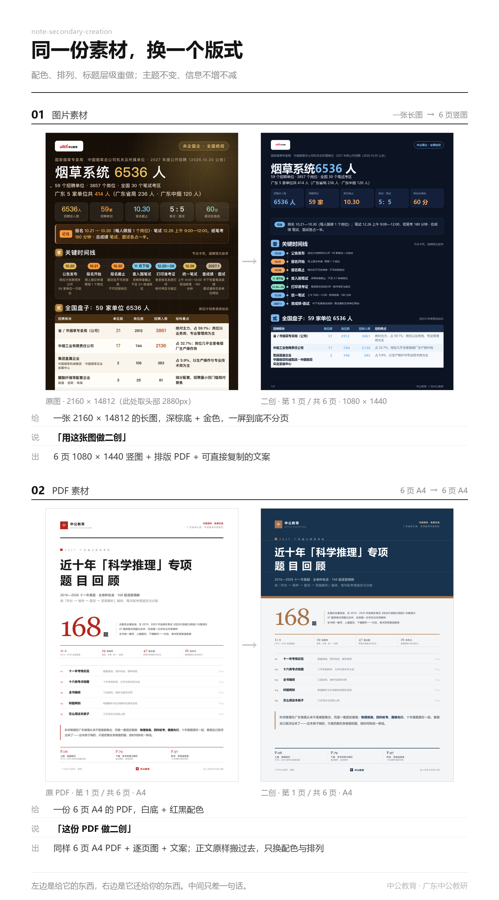

# note-secondary-creation · 素材排版二创 Skill

> 还是那张图，只换了配色和几处排列 —— 一眼能看出是同一个作者做的。

基于原始笔记图片 / PDF 做**轻量二创**的 WorkBuddy Skill：只改配色、模块顺序、局部重排、排版优化和文案微调；不重构主题、不改核心信息、不换视觉体系。在原素材骨架上换配色、换序号形态、换卡片底、调模块顺序，产出同结构、同密度、同调性的新图。固定交付三件套：**1080×1440 图片（PNG）+ 文案.html + 排版版.pdf**，一轮出图不返工。底色一律优先浅色，即使原素材是深底也不沿用深底。

## 安装

**方式一：下载安装包（推荐）**

下载 [`note-secondary-creation_v1.6.zip`](note-secondary-creation_v1.6.zip)（或 [Releases](../../releases) 附件），解压后把 `note-secondary-creation/` 整个文件夹放进 skills 目录：

- 用户级：`~/.workbuddy/skills/`
- 项目级：`<项目>/.workbuddy/skills/`

**方式二：git clone**

```bash
git clone https://github.com/Ccc123665/note-secondary-creation.git
```

## 使用

触发词：`二创`、`排版二创`、`轻改`、`换个版式`、`换配色`、`素材重排`、`防同质化`

| 输入 | 输出 |
|---|---|
| 图片 | 同结构的新排版图片 + 文案（三件套：PNG + 文案.html + 排版版.pdf） |
| PDF | 重新排版成 A4 专业文档 PDF（全文保留一条不删、重点加粗突出），不出小红书图片、不做总结 |

完整工作流、铁律与自检清单见 [SKILL.md](SKILL.md)。

## 目录结构

```
├── SKILL.md          # Skill 主文档（触发词 / 底层约束 / 铁律 / 4 步出图 / 自检）
├── scripts/          # 渲染器（relayout_light / relayout_dark / relayout_pdf / render_note）
├── assets/           # 方正兰亭黑字体 / 中公 logo / 小鹿形象 / 配色板
├── references/       # 视觉系统 / 合规要求 / 交付规范
├── examples/         # 样例（spec + 产出）
└── docs/             # 效果对比图
```

## ⚠️ 字体授权说明

`assets/fonts/` 下的方正兰亭黑系列字体随本 Skill 包一同分发，授权范围为中公教育宣传品制作（中公采购 + 确认可免费商用部分）。**请勿将字体文件单独提取、转售，或用于中公教育宣传品以外的用途。**

## 效果对比



## 版本

| 版本 | 日期 | 要点 |
|---|---|---|
| v1.6 | 2026-10-21 | PDF 二创 = 文档重排：PDF 输入走 `relayout_pdf.py` 出 A4 专业文档 PDF，全文保留、重点突出、不出小红书图片、不做总结 |
| v1.5 | 2026-10-21 | 底层约束三条入规：只用可商用方正兰亭黑、广告合规、必带中公 logo + 小鹿形象 |
